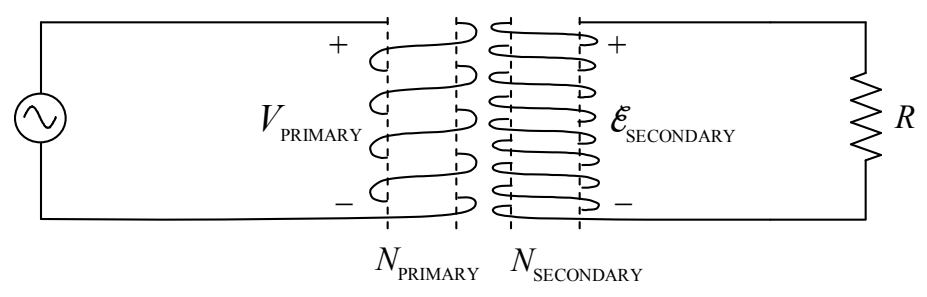

## More on the Transformer

When the primary coil of a transformer is driven by an AC power source, it creates a magnetic field which varies sinusoidally in such a manner as to cause a sinusoidal EMF, of the same frequency as the source, to be induced in the secondary coil. The RMS value of the EMF induced in the secondary coil is directly proportional to the RMS value of the sinusoidal potential difference imposed across the primary. The constant of proportionality is the ratio of the number of turns in the secondary to the number of turns in the primary.

$$
\mathcal{E}_{\text{SECONDARY}} = \frac{N_{\text{SECONDARY}}}{N_{\text{PRIMARY}}} V_{\text{PRIMARY}} \tag{19-3}
$$

When the number of windings in the secondary coil is greater than the number of windings in the primary coil, the transformer is said to be a step-up transformer and the secondary voltage is greater than the primary voltage. When the number of windings in the secondary coil is less than the number of windings in the primary coil, the transformer is said to be a step-down transformer and the secondary voltage is less than the primary voltage.

## The Electrical Power in Your House

When you plug your toaster into a wall outlet, you bring the prongs of the plug into contact with two conductors between which there is a time-varying potential difference characterized as 115 volts 60 Hz AC. The 60 Hz is the frequency of oscillations of the potential difference resulting from a magnet completing 60 rotations per second, back at the power plant. A step-up transformer is used near the power plant to step the power plant output up to a high voltage. Transmission lines at a very high potential, with respect to each other, provide a conducting path to a transformer near your home where the voltage is stepped down. Power lines at a much lower potential provide the conducting path to the wires in your home. 115 volts is the RMS value of the potential difference between the two conductors in each pair of slots in your wall outlets. Since $\mathcal{E}_{\text{RMS}} = \frac{1}{\sqrt{2}} \mathcal{E}_{\text{MAX}}$, we have $\mathcal{E}_{\text{MAX}} = \sqrt{2} \mathcal{E}_{\text{RMS}}$, so $\mathcal{E}_{\text{MAX}} = \sqrt{2} (115 \text{ volts})$, or $\mathcal{E}_{\text{MAX}} = 163 \text{ volts}$. Thus,

$$
\mathcal{E} = (163 \text{ volts}) \sin[2\pi(60 \text{Hz})t]
$$

which can be written as,

$$
\mathcal{E} = (163 \text{ volts}) \sin\left[\left(377 \frac{\text{rad}}{\text{s}}\right)t\right]
$$
