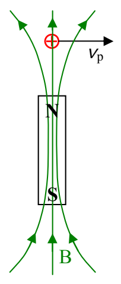
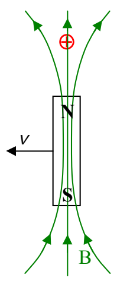

# 20 Faraday’s Law and Maxwell’s Extension to Ampere’s Law

Consider the case of a charged particle that is moving in the vicinity of a moving bar magnet as depicted in the following diagram:

When we view the situation from the reference frame of the magnet, what we see (as depicted just above) is a charged particle moving in a stationary magnetic field. We have already studied the fact that a magnetic field exerts a force $\vec{\mathbf{F}} = q\vec{\mathbf{v}}_{\mathrm{p}}\times \vec{\mathbf{B}}$ on a charged particle moving in that magnetic field. Now let’s look at the same phenomenon from the point of view of the charged particle:

(where $\vec{v} = -\vec{v}_{\mathrm{p}}$ ).

Surely we aren’t going to change the force exerted on the charged particle by the magnetic field of the magnet just by looking at the situation from a different reference frame. In fact we’ve already addressed this issue. What I said was that it is the relative motion between the magnet and the charged particle that matters. Whether the charged particle is moving through magnetic field lines, or the magnetic field lines, due to their motion, are moving sideways through the particle, the particle experiences a force. Now here’s the new viewpoint on this situation: What we say is, that the moving magnetic field doesn’t really exert a force on the stationary charged
