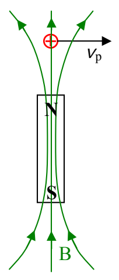
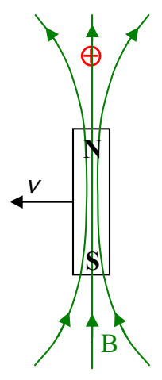

particle, but rather, that by moving sideways through the point at which the particle is located, the magnetic field creates an electric field at that location, and it is the electric field that exerts the force on the charged particle. In this viewpoint, we have, at the location of the stationary charged particle, an electric field that is exerting a force on the particle, and a magnetic field that is exerting no force on the particle. At this stage it might seem that it would be necessary to designate the magnetic field as some special kind of magnetic field that doesn't exert a force on a charged particle despite the relative velocity between the charged particle and the magnetic field. Instead, what we actually do is to characterize the magnetic field as being at rest relative to the charged particle.

So, as viewed from the reference frame in which the magnet is at rest:

the particle experiences a force  $\vec{F}$  directed out of the page in the diagram above due to its motion through the magnetic field.

And, as viewed from the reference frame in which the charged particle is at rest:

the particle finds itself in a stationary magnetic field but experiences the same force  $\vec{F}$  because it also finds itself in an electric field directed out of the page.
