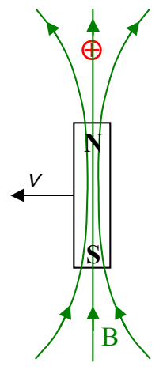

So we have two models for explaining the force on the stationary charged particle in the case depicted by:

In model 1 we simply say that in terms of the Lorentz Force  \( \vec{F}=q\vec{v}\times\vec{B} \) , what matters is the relative velocity between the particle and the magnetic field and to calculate the force we identify the velocity  \( \vec{v}_{p} \)  of the particle relative to the magnetic field as being rightward at magnitude  \( v_{p}=v \)  in the diagram above so  \( \vec{F}=q\vec{v}_{p}\times\vec{B} \)  (where q is the charge of the particle). In model 2 we say that the apparent motion of the magnetic field “causes” there to be an electric field and a stationary magnet field so the particle experiences a force  \( \vec{F}=q\vec{E} \) .

Of course we are using two different models to characterize the same force. In order for both models to give the same result we must have:

$$
\vec{\mathbf{E}} = \vec{\mathbf{v}}_{\mathrm{p}} \times \vec{\mathbf{B}} \tag{20-1}
$$

where:

\( \vec{E} \)  is the electric field at an empty point in space due to the motion of that point relative to a magnetic field vector that exists at that point in space,

\( \vec{v}_{p} \)  is the velocity of the empty point in space relative to the magnetic field vector, and

\( \vec{B} \)  is the magnetic field vector.

Physicists have found model 2 to be more fruitful, especially when attempting to explain magnetic waves. The idea that a magnetic field in apparent sideways motion through a point in space “causes” there to be an electric field at that point in space, is referred to as Faraday’s Law of Induction. Our mnemonic for Faraday’s Law of Induction is: “A changing magnetic field causes an electric field.”
