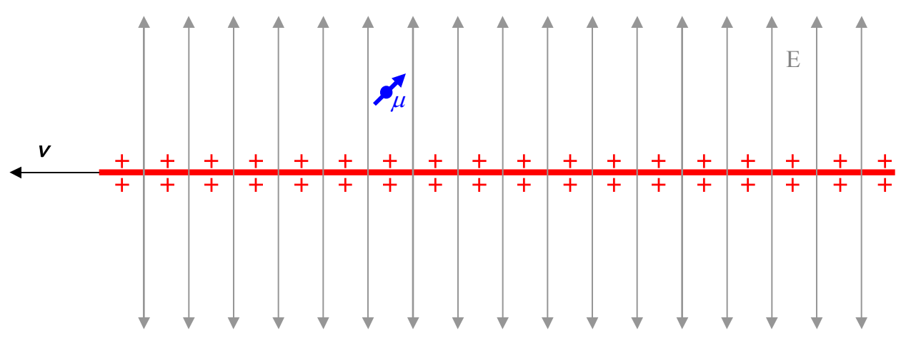
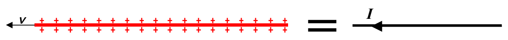

The acceleration experienced by a charged particle in the vicinity of a magnet, when the charged particle is moving relative to the magnet represents an experimental result that we have characterized in terms of the model described in the preceding part of this chapter. The model is useful in that it can be used to predict the outcome of, and provide explanations regarding, related physical processes. Another experimental result is that a particle that has a magnetic dipole moment and is moving in an electric field with a velocity that is neither parallel nor antiparallel to the electric field, does (except for two special magnetic dipole moment directions) experience angular acceleration. We interpret this to mean that the particle experiences a torque. Recalling that a particle with a magnetic dipole moment that is at rest in an electric field experiences no torque, but one that is at rest in a magnetic field does indeed experience a torque (as long as the magnetic dipole moment and the magnetic field it is in are not parallel or antiparallel to each other), you might think that we can model the fact that a particle with a magnetic dipole moment experiences a torque when it is moving relative to an electric field, by defining a magnetic field “caused” by the apparent motion of the electric field relative to the particle. You would be right. To build such a model, we consider a charged particle that is moving in an electric field produced by a long line of charge that is uniformly distributed along the line. We start by depicting the situation in the reference frame in which the particle is at rest and the line of charge is moving:

Note that we have two different ways of accounting for the magnetic field due to the moving line of charge, at the location of the particle with a magnetic dipole moment. The moving line of charge is a current so we can think of the magnetic field as being caused by the current.

The other option is to view the magnetic field as being caused by the electric field lines moving sideways through the particle. There is, however, only one magnetic field, so, the two different ways of accounting for it must yield the same result. We are going to arrive at an expression for
