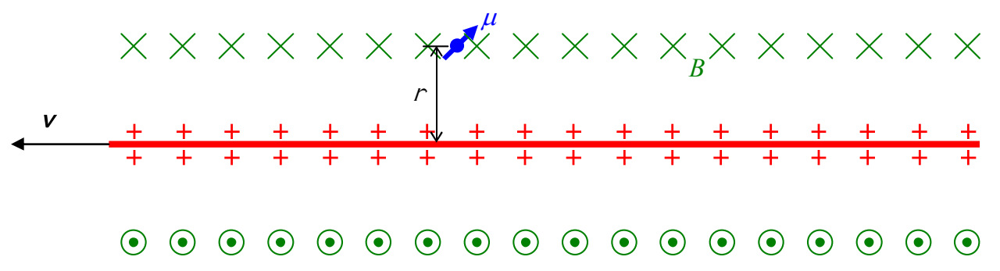

the magnetic field due to the motion of an electric field by forcing the two different ways of accounting for the magnetic field to be consistent with each other. First, we’ll simply use Ampere’s law to determine the magnetic field at the location of the particle.

Let’s define the linear charge density (the charge per length) of the line of charge to be $\lambda$ and the distance that the particle is from the line of charge to be $r$. Suppose that in an amount of time $dt$ the line of charge moves a distance $dx$. Then the amount of charge passing a fixed point on the line along which the charge is moving, in time $dt$, would be $\lambda dx$. Dividing the latter by $dt$ yields $\lambda dx/dt$ which can be expressed as $\lambda v$ and is just the rate at which charge is flowing past the fixed point, that is, it is the current $I$. In other words, the moving line of charge is a current $I = \lambda v$. Back in chapter 17 we gave the experimental result for the magnetic field due to a long straight wire carrying current $I$ in the form of an equation that we called “Ampere’s Law.” It was equation 17-2; it read:

$$B = \frac{\mu_o}{2\pi} \frac{I}{r}$$

and it applies here. substituting $I = \lambda v$ into this expression for $B$ yields

$$B = \frac{\mu_o}{2\pi} \frac{\lambda v}{r} \tag{20-2}$$

By the right hand rule for something curly something straight we know that the magnetic field is directed into the page at the location of the particle that has a magnetic dipole moment, as depicted in the following diagram:

Now let’s work on obtaining an expression for the same magnetic field from the viewpoint that it is the electric field moving sideways through the location of the particle that causes the magnetic field. First we need an expression for the electric field due to the line of charge, at the location of the particle, that is, at a distance $r$ from the line of charge. The way to get that is to consider the line of charge as consisting of an infinite number of bits of charged material, each of which is a segment of infinitesimal length $dx$ of the line of charge. Since the line of charge has a linear charge density $\lambda$, this means that each of the infinitesimal segments $dx$ has charge $\lambda dx$. To get the electric field at the location of the particle that has a magnetic dipole moment, all we have to do is to add up all the contributions to the electric field at the location of the particle, due to all the infinitesimal segments of charged material making up the line of charge. Each contribution is given by Coulomb’s Law for the Electric Field. The difficulty is that there are an infinite
