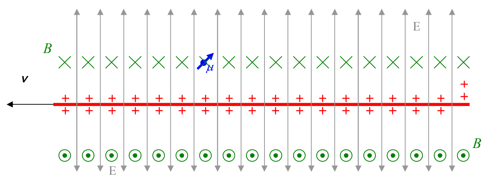

number of contributions. You will be doing such calculations when you study chapter 30 of this textbook. At this stage, we simply provide the result for the electric field due to an infinitely long line of charge having a constant value of linear charge density $\lambda$:

$$E = \frac{\lambda}{2\pi r\epsilon_o}$$

Multiplying both sides by $\epsilon_o$ yields

$$\epsilon_o E = \frac{\lambda}{2\pi r}$$

The expression on the right side of this equation appears in equation 20-2, $B = \frac{\mu_o}{2\pi} \frac{\lambda v}{r}$.

Substituting $\epsilon_o E$ for $\frac{\lambda}{2\pi r}$ where the latter appears in equation 20-2 yields:

$$B = \mu_o \epsilon_o E v$$

This represents the magnitude of the magnetic field that is experienced by a particle when it is moving with speed $v_{\text{p}} = v$ relative to an electric field $\vec{\mathbf{E}}$ when the velocity is perpendicular to $\vec{\mathbf{E}}$. Experimentally we find that a particle with a magnetic dipole moment experiences no torque (and hence no magnetic field) if its velocity is parallel or antiparallel to the electric field $\vec{\mathbf{E}}$. As such, we can make our result more general (not only good for the case when the velocity is perpendicular to the electric field) if we write, E$_{\perp}$ in place of E.

$$B = \mu_o \epsilon_o E_{\perp} v$$

Starting with the preceding equation, we can bundle both the magnitude and the direction (as determined from Ampere's Law and the right hand rule when we treat the moving line of charge as a current, and as depicted in the diagram above) of the magnetic field into one equation by writing:

$$\vec{\mathbf{B}} = \mu_o \epsilon_o \vec{\mathbf{v}} \times \vec{\mathbf{E}}$$
