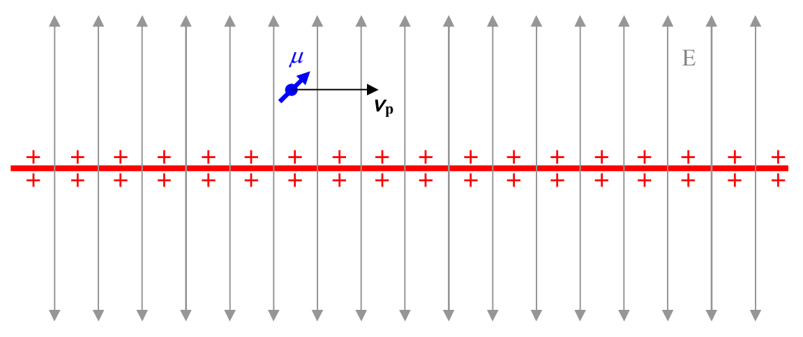
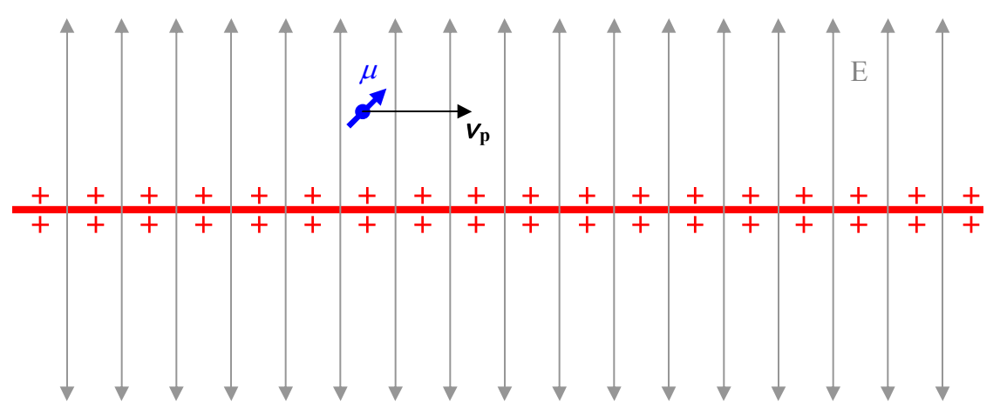

We can express $\vec{B}$ in terms of the velocity $\vec{v}_P$ of the particle relative to the line of charge

(instead of the velocity $\vec{v}$ of the line of charge relative to the particle) just by recognizing that

$$\vec{v}_P = -\vec{v}$$

Substituting this expression $(\vec{v}_P = -\vec{v})$ into our expression for the magnetic field $(\vec{B} = \mu_o \epsilon_o \vec{v} \times \vec{E})$ yields:

$$\vec{B} = -\mu_o \epsilon_o \vec{v}_P \times \vec{E}$$

In this model, where we account for the torque experienced by a particle that has a magnetic dipole moment when that particle is moving in an electric field, by defining a magnetic field $\vec{B} = -\mu_o \epsilon_o \vec{v}_P \times \vec{E}$ which depends both on the velocity of the particle relative to the electric field and the electric field itself, the electric field itself is considered to exert no torque on the charged particle. At this stage it might seem that it would be necessary to designate the electric field as some special kind of electric field that doesn’t exert a torque on a charged particle despite the relative velocity between the charged particle and the electric field. Instead, what we actually do is to characterize the electric field as being at rest relative to the charged particle.

So, as viewed from the reference frame in which the line of charge is at rest:

