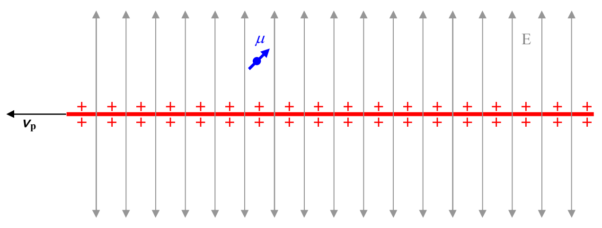

the particle that has a magnetic dipole moment experiences a torque due to its motion through the electric field.

And, as viewed from the reference frame in which the particle is at rest:

the particle that has a magnetic dipole moment finds itself in a stationary electric field but experiences the same torque because it also finds itself in a magnetic field directed, in the diagram above, into the page. One way of saying what is going on here is to say that, loosely speaking: A changing electric field “causes” a magnetic field. The phenomenon of a changing electric field “causing” a magnetic field is referred to as Maxwell’s Extension to Ampere’s Law.

So far, in this chapter we have addressed two major points: A magnetic field moving sideways through a point in space causes there to be an electric field at that point in space, and, an electric field moving sideways through a point in space causes there to be a magnetic field at that point in space. In the remainder of this chapter we find that putting these two facts together yields something interesting.

Expressing what we have found in terms of the point of view in which point P is fixed and the field is moving through point P with speed $\vec{v} = -\vec{v}_{p}$, we have: a magnetic field vector $\vec{B}$ moving with velocity $\vec{v}$ transversely through a point in space will “cause” an electric field $\vec{E} = -\vec{v} \times \vec{B}$ at that point in space; and; an electric field vector moving with velocity $\vec{v}$ transversely through a point in space will “cause” a magnetic field $\vec{B} = \mu_{o} \epsilon_{o} \vec{v} \times \vec{E}$ at that point in space. The word “cause” is in quotes because there is never any time delay. A more precise way of putting it would be to say that whenever we have a magnetic field vector moving transversely through a point in space, there exists, simultaneously, an electric field $\vec{E} = -\vec{v} \times \vec{B}$ at that point in space, and whenever we have an electric field vector moving transversely through a point in space there exists, simultaneously, a magnetic field $\vec{B} = \mu_{o} \epsilon_{o} \vec{v} \times \vec{E}$ at that point in space.
