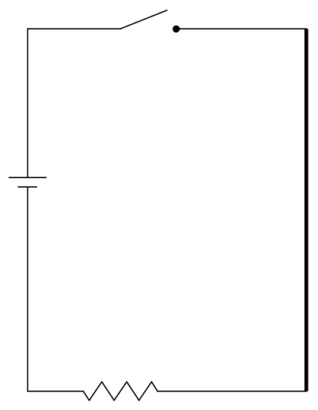

Consider the following circuit. Assume that we are looking down on the circuit from above, meaning that into the page is downward, and out of the page is upward.

I want you to focus your attention on the rightmost wire of that circuit. As soon as someone closes that switch we are going to get a current through that wire and that current is going to produce a magnetic field. By means of the right-hand rule for something curly something straight, with the current being the something straight, and our knowledge that straight currents cause magnetic fields that make loops around the current, we can deduce that there will be an upward-directed (pointing out of the page) magnetic field at points to the right of the wire. In steady state, we understand that the upward-directed magnetic field vectors will be everywhere to the right of the wire with the magnitude of the magnetic field vector being smaller the greater the distance the point in question is from the wire. Now the question is, how long does it take for the magnetic field to become established at some point a specified distance to the right of the wire? Does the magnetic field appear instantly at every point to the right of the wire or does it take time? James Clerk Maxwell decided to explore the possibility that it takes time, in other words, that the magnetic field develops in the vicinity of the wire and moves outward with a finite velocity.

Here I want to talk about the leading edge of the magnetic field, the expanding boundary within which the magnetic field already exists, and outside of which, the magnetic field does not yet exist. With each passing infinitesimal time interval another infinitesimal layer is added to the region within which the magnetic field exists. While this is more a case of magnetic field vectors growing sideways through space, the effect of the motion of the leading edge through space is the same, at the growing boundary, as magnetic field vectors moving through space. As such, I am going to refer to this magnetic field growth as motion of the magnetic field through space.
