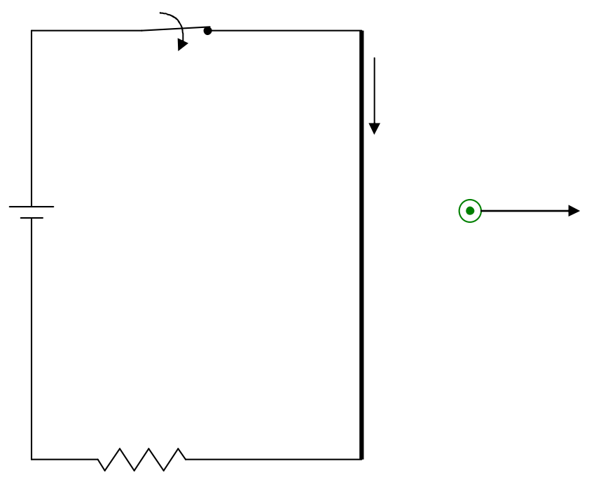

To keep the drawing uncluttered I'm going to show just one of the infinite number of magnetic field vectors moving rightward at some unknown velocity (and it is this velocity that I am curious about) as the magnetic field due to the wire becomes established in the universe.

Again, what I'm saying is that, as the magnetic field builds up, what we have, are rightward-moving upward (pointing out of the page, toward you) magnetic field lines due to the current that just began. Well, as a magnetic field vector moves through whatever location it is moving through, it “causes” an electric field  $\vec{E} = -\vec{v} \times \vec{B}$ .
