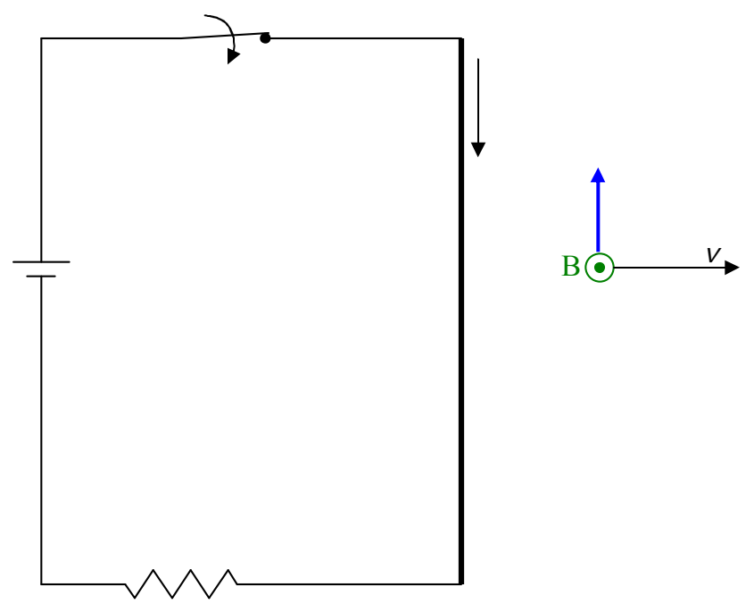

At any point $P$ through which the magnetic field vector passes, an electric field exists consistent with $\vec{E} = -\vec{v} \times \vec{B}$. What this amounts to is that we have both a magnetic field and an electric field moving rightward through space. But we said that an electric field moving transversely through space “causes” a magnetic field. More specifically we said that it is always accompanied by a magnetic field given by $\vec{B} = \mu_o \epsilon_o \vec{v} \times \vec{E}$. Now we’ve argued around in a circle. The current “causes” the magnetic field and its movement through space “causes” an electric field whose movement through space “causes” the magnetic field. Again, the word “causes” here should really be interpreted as “exists simultaneously with.” Still, we have two explanations for the existence of one and the same magnetic field and the two explanations must be consistent with each other. For that to be the case, if we take our expression for the magnetic field “caused” by the motion of the electric field,

$$\vec{B} = \mu_o \epsilon_o \vec{v} \times \vec{E}$$

and substitute into it, our expression $\vec{E} = -\vec{v} \times \vec{B}$ for the electric field “caused” by the motion of the magnetic field, we must obtain the same $\vec{B}$ that, in this circular argument, is “causing” itself. Let’s try it. Substituting $\vec{E} = -\vec{v} \times \vec{B}$ into $\vec{B} = \mu_o \epsilon_o \vec{v} \times \vec{E}$, we obtain:

$$\vec{B} = -\mu_o \epsilon_o \vec{v} \times (\vec{v} \times \vec{B})$$

All right. Noting that $\vec{v}$ is perpendicular to both $\vec{B}$ and $\vec{v} \times \vec{B}$, meaning that the magnitude of the cross product, in each case, is just the product of the magnitudes of the multiplicand vectors, we obtain:

$$\vec{B} = \mu_o \epsilon_o v^2 \vec{B}$$
