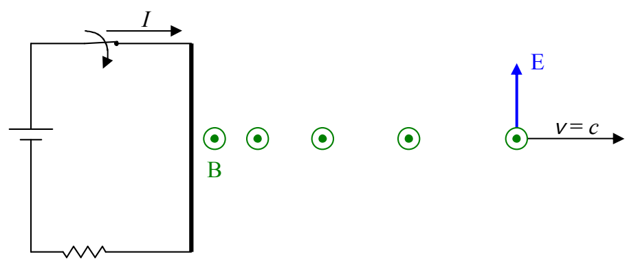
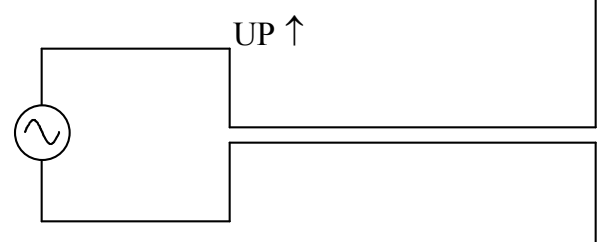

## 21 The Nature of Electromagnetic Waves

When we left off talking about the following circuit:

we had recently closed the switch and the wire was creating a magnetic field which was expanding outward. The boundary between that part of the universe in which the magnetic field is already established and that part of the universe in which the magnetic field has not yet been established is moving outward at the speed of light,  $c = 3.00 \times 10^{8}$  m/s. Between that boundary and the wire we have a region in which there exists a steady unmoving magnetic field. Note that it was the act of creating the current that caused the magnetic field “edge” that is moving at the speed of light. In changing from a no-current situation to one in which there was current in the wire, charged particles in the wire went from no net velocity in the along-the-wire direction to a net velocity along the wire, meaning, that the charged particles were accelerated. In other words, accelerated charged particles cause light. We can also cause light by means of the angular acceleration of particles having a magnetic dipole moment, but, the short answer to the question about what causes light, is, accelerated charged particles.

Here's a simple circuit that one might use to intentionally cause light:

The vertical arrangement of wires on the right is referred to as a dipole antenna. As the AC power source alternately causes charge to surge upward in both parts of the antenna, and then downward, the dipole antenna creates electric and magnetic fields that oscillate sinusoidally in both time and space. The fields propagate through space away from the antenna at the speed of light.
