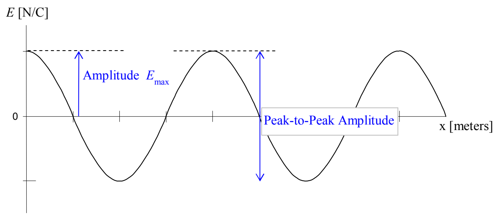

The charged particles oscillating up and down in the antenna causes waves of electric and magnetic fields known as light. The frequency of the waves is the same as the frequency of oscillations of the particles which is determined by the frequency of the power source. The speed of the waves is the speed of light $c = 3.00 \times 10^8$ m/s, because the waves are light. For any kind of wave, the frequency, wavelength, and wave speed are related by:

$$v = \lambda f$$

which, in the case of light reads:

$$c = \lambda f$$

Here’s a quick pictorial review of some properties of waves. In the case of light, we have electric and magnetic fields oscillating in synchronization with each other. It is customary to characterize the waves in terms of the electric field. I’ll do that here, but, one should keep in mind that the magnetic field oscillates and moves in the same manner that the electric field does, but, at right angles to the electric field.

