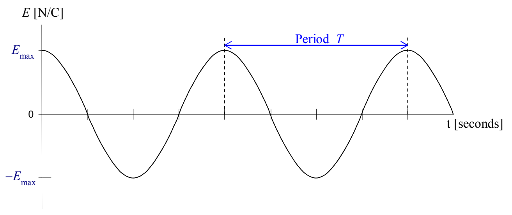
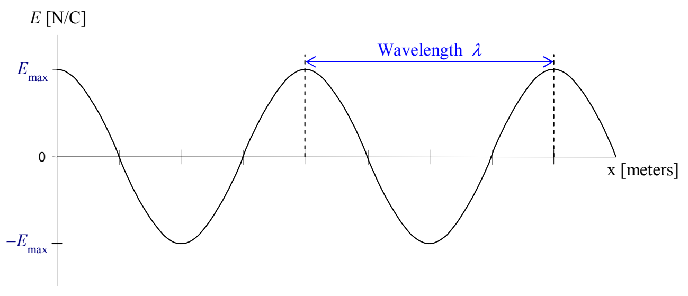

The intensity of a wave is proportional to the square of its amplitude, so, in the case of light:

$$\mathcal {I} \propto (E _ {\text {MAX}}) ^ {2}$$

The frequency of light is determined by the frequency of oscillations of the charged particles constituting the source of the light. How we categorize light depends on the frequency of the light. In order of increasing frequency, we refer to light as: radio waves, microwaves, infrared
