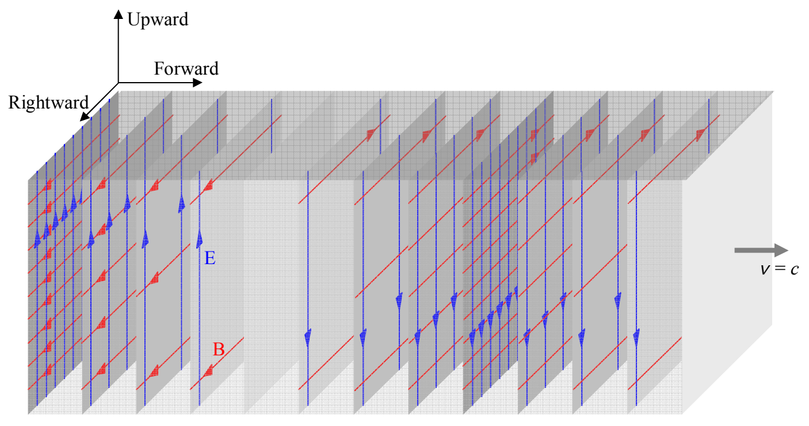
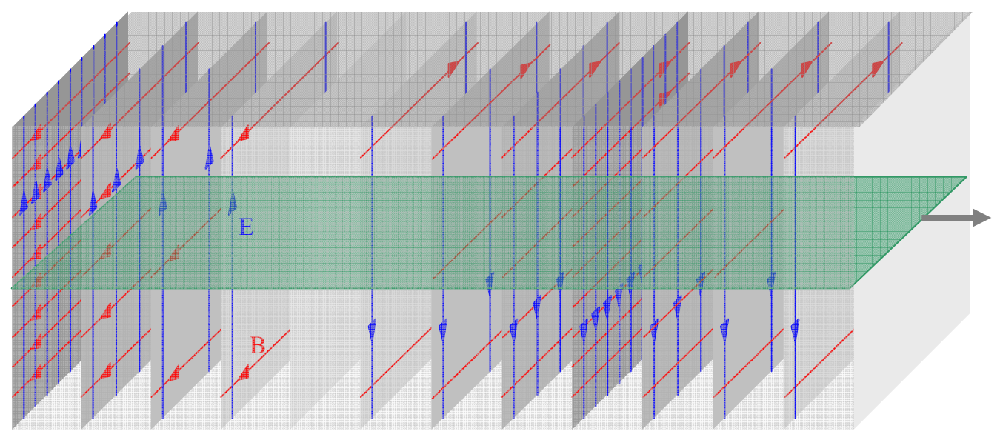

Here's one way of depicting a portion of a beam of light traveling forward through space, at an instant in time:

Each “sheet” in the diagram characterizes the electric (vertical arrows) and magnetic (horizontal arrows) fields at the instant in time depicted. On each sheet, we use the field diagram convention with which you are already familiar—the stronger the field, the more densely packed the field lines in the diagram.

Consider the one thin horizontal slice of the beam depicted in this diagram:

