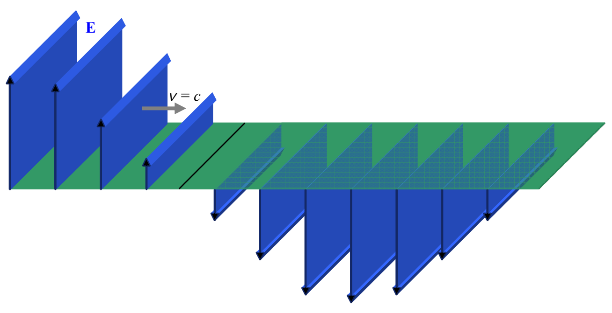

Here we depict the electric field on that one thin horizontal region:

This is a simpler diagram with less information which is, perhaps, easier to interpret, but, also, perhaps, easier to misinterpret. It may for instance, be more readily apparent to you that what we are depicting (as we were in the other diagram) is just  $\frac{3}{4}$  of a wavelength of the wave. On the other hand, the diagram is more abstract—the length of the electric field vectors does not represent extent through space, but rather, the magnitude of the electric field at the tail of the arrow. As mentioned, the set of locations of the tails of the arrows, namely the horizontal plane, is the only place the diagram is giving information. It is generally assumed that the electric field has the same pattern for some distance above and below the plane on which it is specified in the diagram. Note the absence of the magnetic field. It is up to the reader to know that; as part of the light, there is a magnetic field wherever there is an electric field, and that, the greater the electric field, the greater the magnetic field, and that the magnetic field is perpendicular both to the direction in which the light is going, and to the electric field. (Recall that the direction of the magnetic field is such that the vector  $\vec{E} \times \vec{B}$  is in the same direction as the velocity of the wave.)
