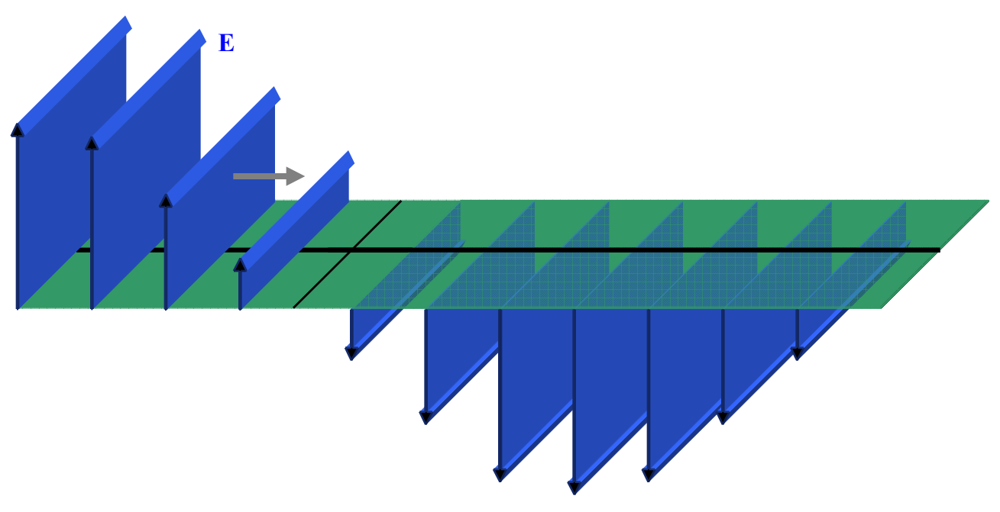
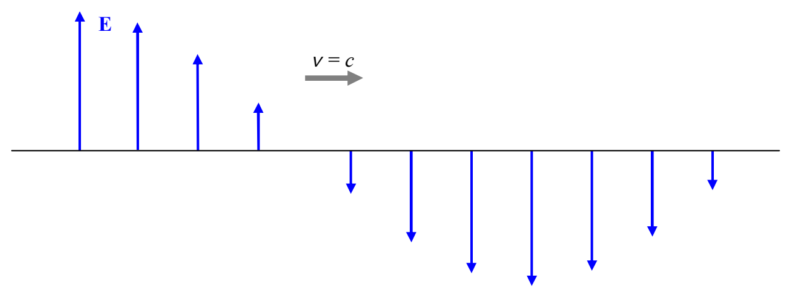

What is perhaps the most common graphical representation of a wave traveling to the right, characterizes the electric and magnetic fields along but a single line extending along the center of the beam in the direction of travel. An example of such a line would be the line along the center of the plane in the following copy of the diagram we have been working with:

An example of an electric field depiction, on a single line along the direction of travel, would be:

