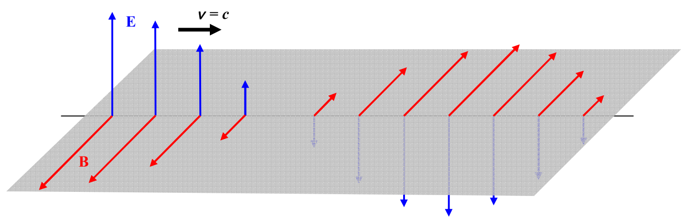
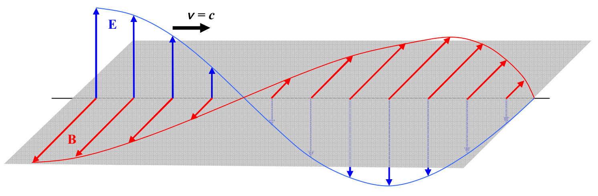

It is important to keep in mind that the arrows are characterizing the electric field at points on the one line, and, it's the length of the arrow that indicates the strength of the electric field at the tail of the arrow, not the spacing between arrows.

The simplicity of this field-on-a-line diagram allows for the inclusion of the magnetic field vectors in the same diagram:

If one connects the tips of the arrows in this kind of diagram, the meaning of those Electric Field vs. Position sinusoidal curves presented in the last chapter becomes more evident:

Huygens' Principle involves wavefronts. A wavefront is the part of a wave which is at a surface that is everywhere perpendicular to the direction in which the wave is traveling. If such surfaces are planes, the wave is called a plane wave. The kind of wave we have been depicting is a plane
