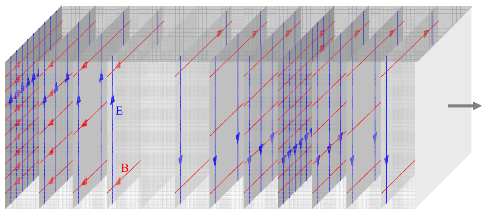
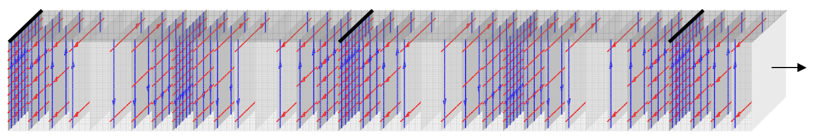
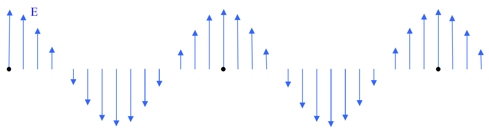

wave. The set of fields on any one of the gray “sheets” on in the diagram:

is a part of a wavefront. It is customary to focus our attention on wavefronts at which the electric and magnetic fields are a maximum in one direction. The rearmost sheet in the diagram above represents such a wavefront.

In the following diagram, you see black lines on the top of each sheet representing maximum-upward-directed-electric-field wavefronts.

And, in the following, each such wavefront is marked with a black dot:

