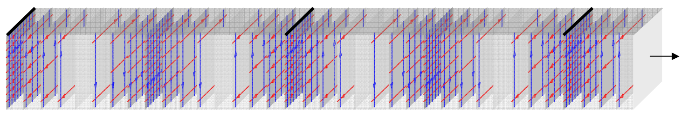
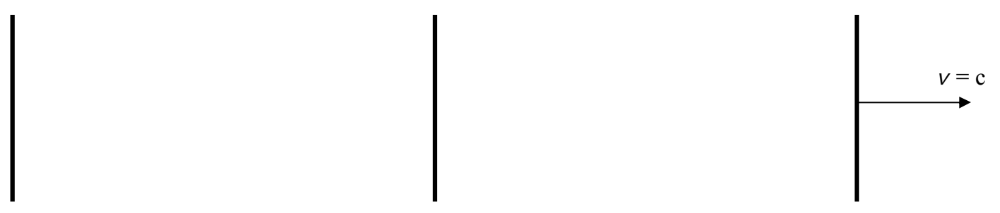
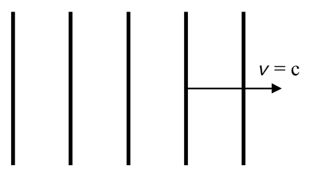

A common method of depicting wavefronts corresponds to a view from above, of the preceding electric field sheet diagram which I copy here:

Such a wavefront diagram appears as:

More commonly, you'll see more of them packed closer together. The idea is that the wavefronts look like a bird's eye view of waves in the ocean.

Note that the distance between adjacent maximum-field wavefronts, as depicted here, is one wavelength.

At this point we are ready to use the Huygens's Principle idea, the notion of a wavefront, and our understanding of the way physicists depict wavefronts diagrammatically, to explore the phenomenon of two slit interference.
