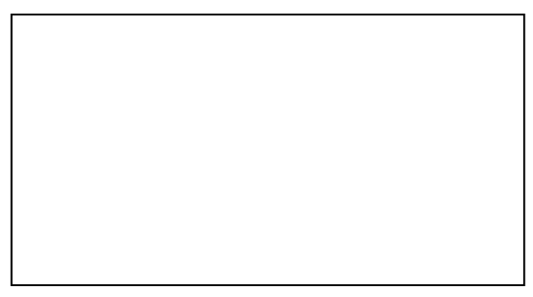
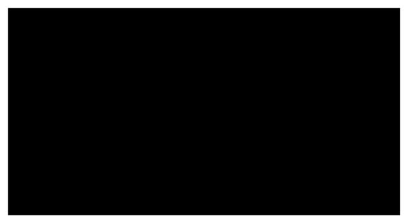

## Two-Slit Interference

When you shine plane-wave visible light through a mask with two parallel slits cut into it, onto a screen, under certain circumstances (which we shall discuss) you see, on the screen, an extended pattern of bright and dark bands where you might expect to see two bright lines surrounded by darkness which we might call the shadow of the mask.

I use the kind of double slit mask that students make in a double-slit laboratory exercise to convey what we mean by a mask with a double slit in it. We obtain rectangular pieces of thin plate glass of about the size depicted in the following diagram:

Prior to the laboratory session, we spray paint each mask with flat black spray paint which is given ample time to dry. Each student is given a razor-blade knife, a metal ruler, and a painted piece of glass that looks like this:

