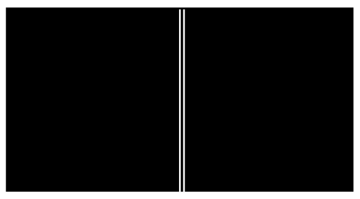
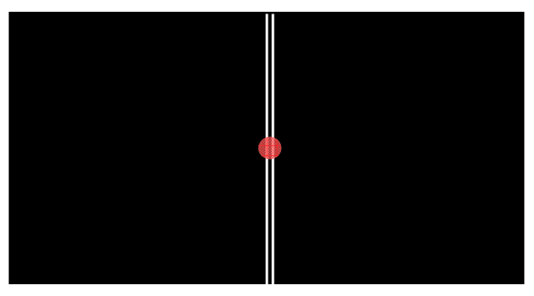
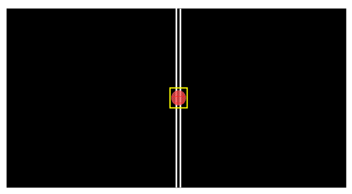

The students use the ruler and knife to etch two parallel lines in the paint. After they are done their masks looks like this:

The double slit is illuminated with light from a laser. The laser beam hits the mask “head on”. More specifically, the direction in which the light is traveling is at right angles to the surface of the mask. Such light is said to be normally incident upon the mask. (Recall that the word “normal” means “at right angles to.” Make sure you know what we mean by the statement that light is normally incident upon a mask with a double slit in it.)

On a white paper screen behind the mask, aligned the same way the mask is, the students see a pattern of bright and dark bands distributed horizontally over the face of the screen. The bright bands are typically referred to as fringes. In cases (unlike the laboratory exercise under discussion) where the width of each fringe is small compared to its height, the fringes are often referred to as lines.

Huygens' Principle helps us understand this phenomenon. The phenomenon is an interference phenomenon. Aside from the need for the slits to be close enough together for the beam to “hit” both slits at the same time, the slits, for reasons that will soon be clear, must be close to each other. In analyzing the phenomenon here, I am going to “zoom in” on the small piece of the mask outlined in the following diagram:

