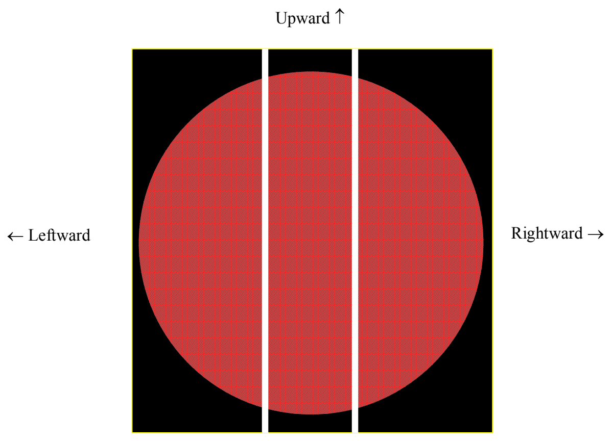
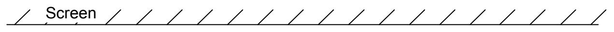
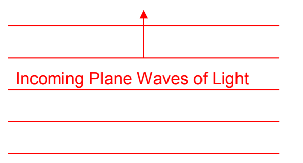

I'm going to call the direction in which the light is traveling, on its way to the mask (which is into the page in the diagram above) the *forward* direction. Now, I am going to depict the entire situation as viewed from above from above.

Forward ↑

← Leftward

Rightward →

Mask with Double Slit

