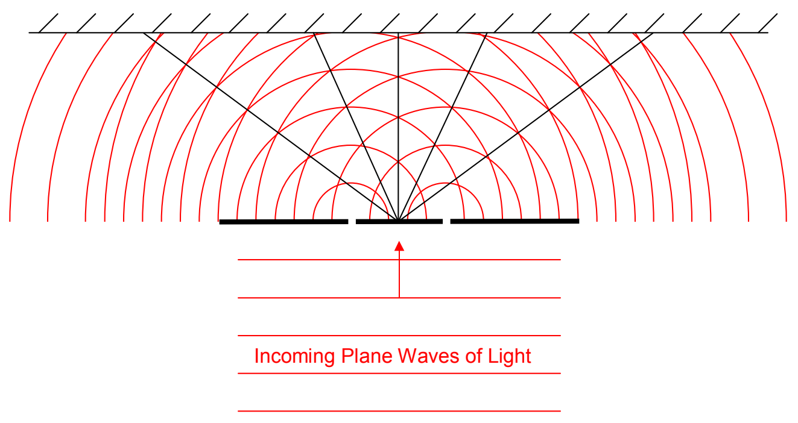

Treating the interface of each slit as a point source in accord with Huygens’ Principle, and representing the intersections of the spherical wavefronts with the plane of the page, we have:

The line and circle segments representing the wavefronts correspond to points in space where, at the instant in question, the electric field is maximum in one particular direction. While the direction can be any direction perpendicular to the direction in which the waves are traveling, to make the discussion easier, let’s assume that the electric field oscillations are vertical (into and out of the page) and that the wavefronts represent points in space at which, at the instant in question, the electric field is maximum *upward*. At those points in space forward of the source, the electric field due to each point-like source varies periodically from upward and maximum (call it $\mathrm{E}_{\text{max}}$ , see footnote$^{1}$), to zero, to downward and maximum ($-\mathrm{E}_{\text{max}}$), back to zero, and back to maximum upward ($\mathrm{E}_{\text{max}}$), with a frequency that we call the frequency of the light waves. At those points in space forward of the source, the total electric field is the sum of the contribution to the electric field from the left slit and the contribution to the electric field from the right slit. Thus, for the instant depicted in the diagram, where the wavefronts cross, we have both contributions at a maximum in one and the same direction. So the total electric field at such points is, at the instant in question, twice that due to either source. As time elapses, the electric field varies at such points, from $2\,\mathrm{E}_{\text{max}}$ to 0 to $-2\,\mathrm{E}_{\text{max}}$ to 0, and back to $2\,\mathrm{E}_{\text{max}}$; repeatedly. The intensity of the light at such a position is 4 times what the intensity due to either slit alone would be. The superposition of the time-varying electric fields is called interference, and when the various contributions add together to form an electric field that varies with an amplitude that is bigger than the electric field due to any individual contributor, we call the interference constructive.

$^{1}$ At any position through which the light under discussion travels, the electric field of that light varies sinusoidally with time. I’m using the symbol $\mathrm{E}_{\text{max}}$ to represent the amplitude of the oscillations due to one source at such a point. This amplitude is different at different locations, both because of diminishment with distance from the source, and, because both of the point-like sources under discussion here are actually infinite sets of point sources themselves.
