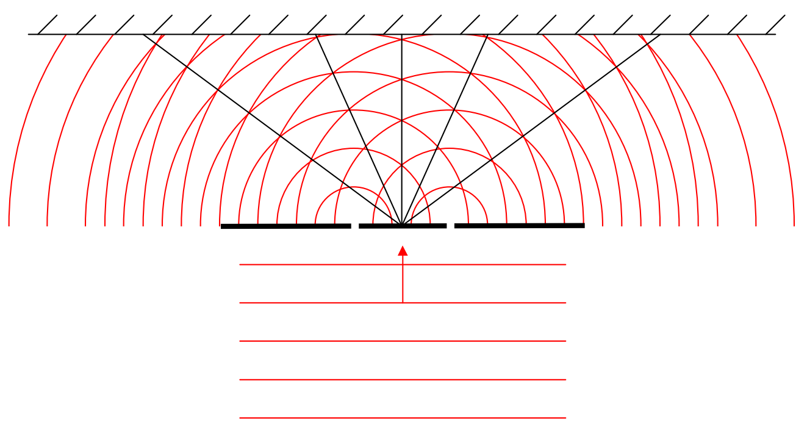

Note that the points where the wavefronts cross lie on, or very near, straight lines extending out from the midpoint between the slits:

The big deal is, that at every point on those lines (except “too” close to the slits) the electric field is oscillating with an amplitude of  $2E_{max}$ . If we were to let time continually elapse, you would see those crossing points continually being created near the slits, moving onto the lines and outward along the lines toward the screen. At every point on the lines (except “too” close to the slits), the interference is always constructive at every instant in time. For instance, for the same instant depicted in the diagram above, consider the electric field on the wavefronts midway between the wavefronts depicted. On these “midway between” wavefronts, the electric field is maximum downward. I am going to redraw the wavefront diagram above, minus the maximum-upward (electric field vector) wavefronts, but with the maximum-downward wavefronts (depicted with dashed lines). Again, this diagram is for the same instant in time characterized by the diagram above. Also, I am going to leave those same straight lines along which the constructive interference is occurring, on the diagram.
