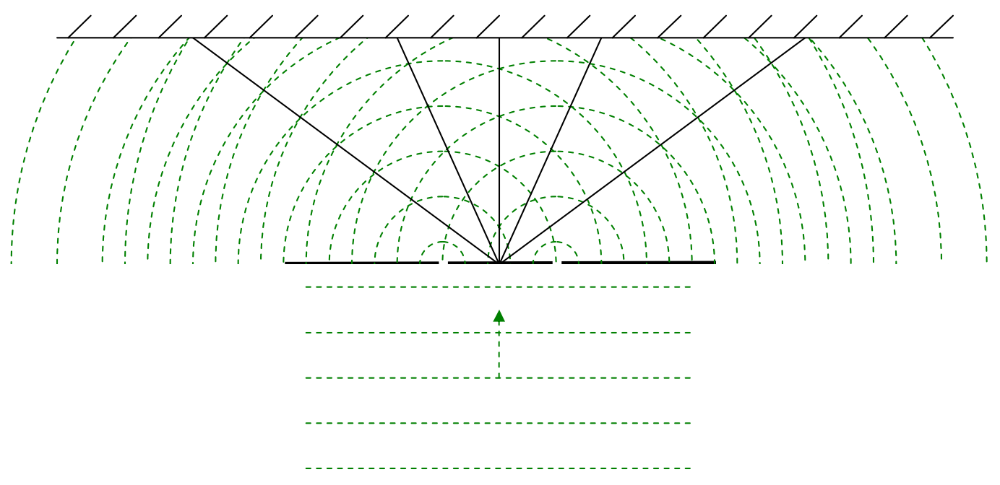

Note that, indeed, (except for “too close” to the slits), the maxima (wavefront crossing points) for the maximum-downward-electric-field vector wavefronts, occur along the exact same lines that the maximum-upward-electric-field vector wavefronts occurred along. Again, I want to stress that the amplitude of oscillations is maximal $(2E_{\text{max}})$ at every point on each of those lines—at points on the lines other than where the wavefronts are crossing, it is just that the electric field is at different stages of those maximum-amplitude oscillations.

Where the lines consisting of points of maximal constructive interference intersect the screen, we see a bright fringe. How about the dark fringes? Those result at points in space where the electric field from one slit always cancels the electric field from the other slit. We can find such points by depicting the maximum-upward-electric-field wavefronts from one slit at a particular instant, while, on the same diagram, depicting the maximum-downward-electric-field wavefronts from the other slit. Where they cross, we have perfect cancellation, not just for the instant depicted, but, for all time.
