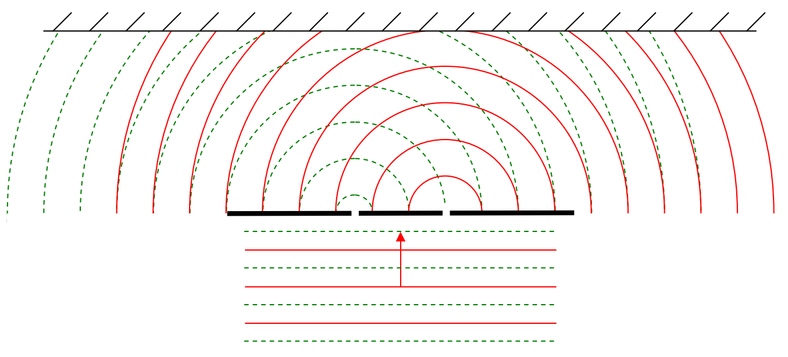
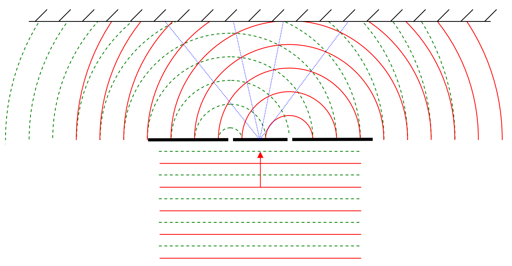

Here we show maximum-downward-electric-field wavefronts from the left slit interfering with maximum-upward-electric-field wavefronts from the right slit:

Again, except for very close to the slits, the points of intersection of the oppositely-directed electric field wavefronts, the points of destructive interference, lie on lines (not the same lines as before) extending outward from the point on the mask that is midway between the slits:

Along these lines, the interference is always completely destructive. Where they intersect the screen, we see dark (unilluminated) fringes.
