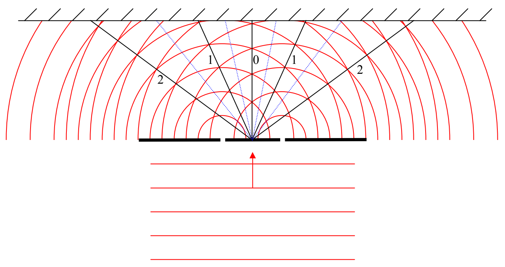

If we put these lines on which destructive interference always occurs on the diagram with the lines along which constructive interference always occurs,

we see that the angles at which destructive interference always occurs look like they are about midway between the angles at which constructive interference always occurs.

Okay, it’s time to get quantitative. It’s probably pretty obvious to you that the pattern depends on the wavelength of the light and the spacing between the slits. What we need to do to put an end to this chapter is to find a mathematical relationship between the angles at which the maxima (bright light) and minima (darkness, a.k.a. zero light) occur. I am going to use the symbol $\theta$ to represent the angle that whichever maximum or minimum we are focusing on at the time, occurs. We number the maxima 0, 1, 2, … working out from the middle in both directions as indicated on the diagram above. The minima are labeled 1, 2, 3 (there is no “0” minimum), also working out from the middle. To avoid clutter, I have not labeled the minima in the diagram. If necessary, use those numbers as subscripts on the angle $\theta$ to distinguish one angle at which a maximum occurs from another, and, to distinguish one angle at which a minimum occurs from another. If it is not clear from the context, the superscripts $^{\text{MAX}}$ and $^{\text{MIN}}$ may also be needed. The angle of a particular maximum or minimum to the left is always the same as the angle of the corresponding maximum or minimum to the right, so we don’t need to differentiate between left and right.

The two slits represent a special pair of sources. What’s special about such a pair of sources is that the two sources are exactly in synchronization with each other. That is, for instance, when one is producing a maximum-upward electric field vector, so is the other. We say that the two sources are in phase with each other. Another thing that is special about the sources is that, because we consider each slit to be the same size as the other, and the light from the source to be of one and the same intensity across the face of the beam, the amplitude of the oscillations is the
