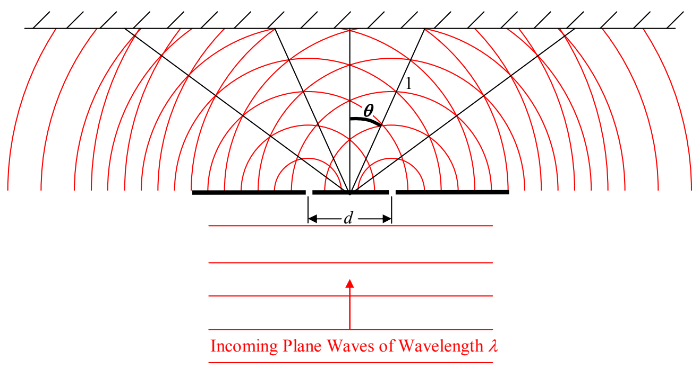

same for each. This is why we get total cancellation along the lines on which the minima occur. By inspection of the diagram, it is clear that, to get to any point on the line in the straight-ahead direction, the distance that the light from one slit travels is the same as the distance that light from the other slit travels. As such, at any point along the center line (the line extending from the midpoint between the two slits, straight ahead) whenever a crest (maximum upward electric field) arrives from one slit, a crest arrives from the other slit; and; whenever a trough (maximum downward electric field) arrives from one slit, a trough arrives from the other slit. Thus, on the centerline, the interference is always constructive. So, we have one quantitative result already, a maximum (constructive interference, bright fringe) occurs at  $\theta = 0^{\circ}$ .

Let's define the center-to-center slit spacing to be $d$, and, the wavelength of the incoming plane waves to be $\lambda$. We'll work on finding an expression for the angle $\theta$ at which the first maximum occurs, first.

Let's redraw the diagram with a little less clutter to see what's going on.
