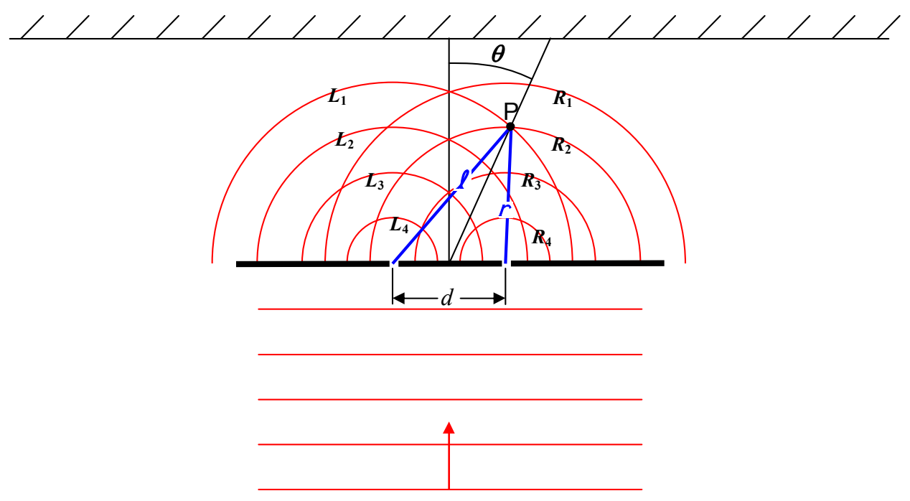

I removed some of the spherical wavefronts and labeled the wavefronts from the left slit $L_1$, $L_2$, $L_3$, and $L_4$ corresponding to the order in which they came from the left slit. Similarly, wavefronts from the right slit are labeled $R_1$, $R_2$, $R_3$, and $R_4$ corresponding to the order in which they came from the right slit. Furthermore, I have indicated the distance $\ell$ from the left slit to one point (point $P$) on the line of maxima, and, the distance $r$ from the right slit to the same point $P$ on the line of maxima.

Look at the diagram and note that, although $R_1$ and $L_1$ originate from their respective slits at one and the same instant, as do $R_2$ and $L_2$, it is $R_2$ and $L_1$ that arrive at point $P$ together. By the time it arrives at point $P$, $L_1$ has been traveling for a greater amount of time than $R_2$ has, but, $L_1$ arrives at point $P$ at the same time as $R_2$ does because it $(L_2)$ has a greater distance to travel. This is the whole key to constructive interference. At any point illuminated by two in-phase sources there will be constructive interference if the point is the same distance from both sources, or, when the distance is different, if that difference is one wavelength, two wavelengths, three wavelengths, or, for that matter, any integer number of wavelengths. If the path difference is an integer number of wavelengths, then, whatever part of the wave is arriving from one source, the same part of the wave will be arriving from the other source. So, for instance, crest arrives with crest, and trough arrives with trough. Defining

$$\Delta s = \ell - r$$

we have:

$$\Delta s = m\lambda \qquad (m = 0, 1, 2, \dots)$$

as our condition for constructive interference.
