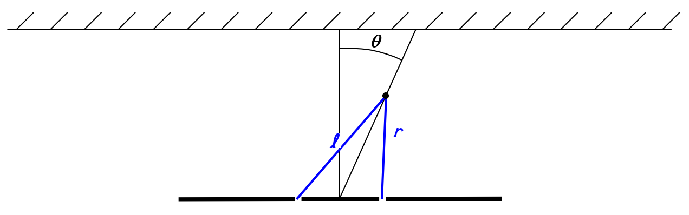
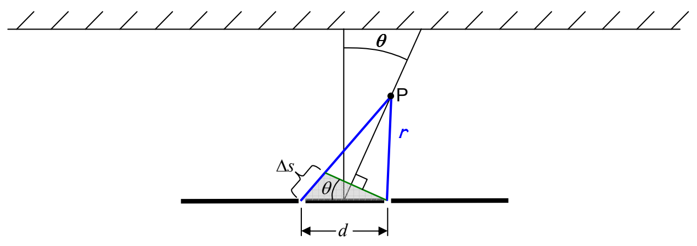

Now I provide the diagram we have been working with, without the wavefronts, so that we can do the geometry needed to relate $\Delta s$ to the angle $\theta$.

First I want to draw a line segment perpendicular to our line of maximum interference, ending on the right slit.

The new line segment breaks up the path of length $\ell$ into a part identical in length to the one of length $r$, and a part whose length is the path-length difference $\Delta s$. The new line segment also forms a triangle, the one that is shaded in the diagram. Using plane geometry, I have identified the angle labeled $\theta$ in the small triangle as the same angle $\theta$ that the line of maximal constructive interference makes with the straight-ahead direction. I need to blow up that triangle so that we can analyze it:
