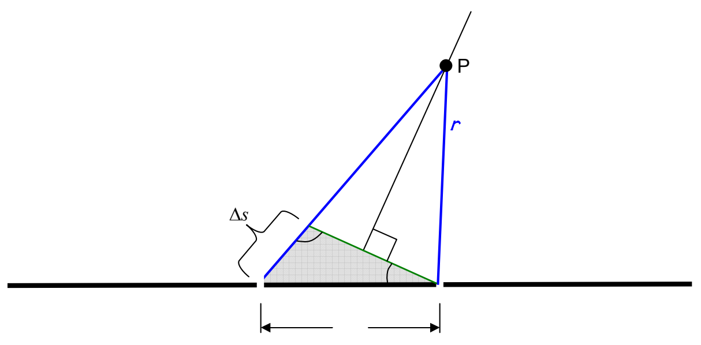

Okay, now we make an approximation. See angle $\phi$ in the shaded triangle? It is approximately equal to $90^\circ$. Indeed, the farther point $P$ is from the slits, the closer $\phi$ is to $90^\circ$. All we need is for the distance from the slits to point $P$ to be large compared to the distance between the slits. In practice, this is realized in an actual double-slit experiment. The distance to point $P$ is typically thousands to millions of times greater than the distance between the slits. The approximation in question is thus, typically, a fantastic approximation. Treating $\phi$ as a right angle makes the shaded triangle a right triangle, meaning that the path difference can be expressed as:

$$
\Delta s = d \sin \theta
$$

This is the relation we've been looking for. Combining it with the fact that the path difference has to be an integer number of wavelengths for interference maxima we have:

$$
m \lambda = d \sin \theta \quad (m = 0, 1, 2, \dots) \tag{22-1}
$$

as the condition for maximum constructive interference.

For perfectly destructive interference, the path difference must be half a wavelength or, half a wavelength more than any integer number of wavelengths. So, for interference minima we have:

$$
(m + \frac{1}{2}) \lambda = d \sin \theta \quad (m = 0, 1, 2, \dots) \tag{22-2}
$$

The value of the integer $m$ is referred to as the order of interference. Thus, the first maximum to either side of the straight-ahead direction is referred to as the first order maximum, the next one is called the second order maximum, etc.
