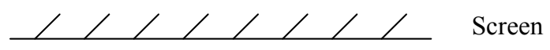
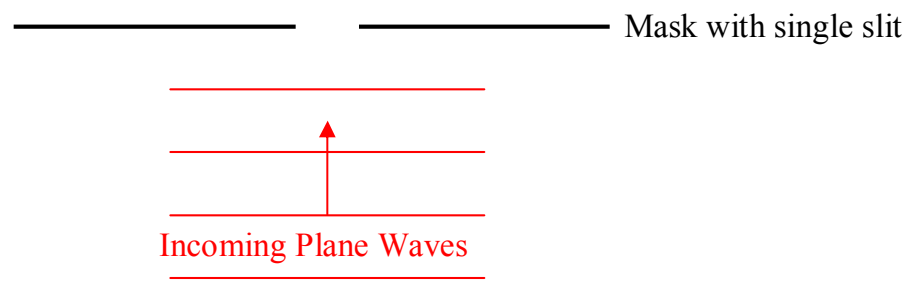

## 23 Single-Slit Diffraction

Single-slit diffraction is another interference phenomenon. If, instead of creating a mask with two slits, we create a mask with one slit, and then illuminate it, we find, under certain conditions, that we again get a pattern of light and dark bands. It is not the same pattern that you get for two-slit interference, but, it's quite different from the single bright line in the straight-ahead direction that you might expect. Here's how it comes about. Firstly, here's the setup:

Again, we get a bright fringe in the straight-ahead position on the screen. From there, working out to either side, we get bands that alternate between dark and bright. The first maximum to the right or left of the central maximum is not nearly as bright as the central maximum. And each maximum after that is less bright than the maximum preceding it. As far as the analysis goes, I want to start with the minima. Consider an imaginary line extending out from the midpoint of the slit all the way to the screen.
