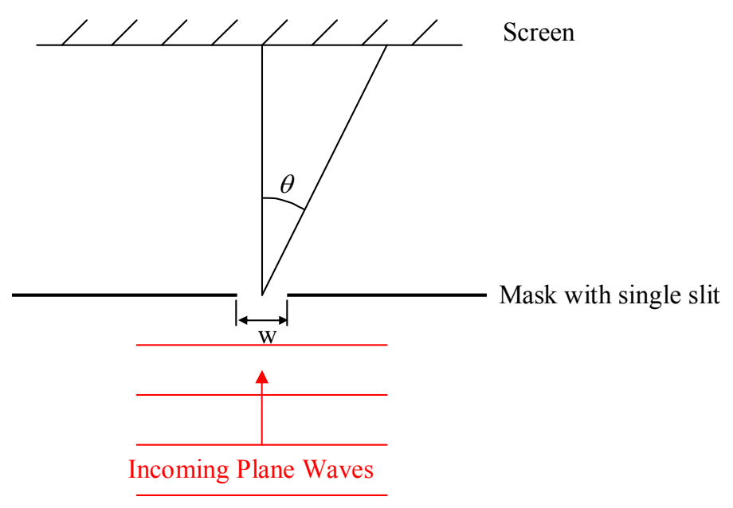
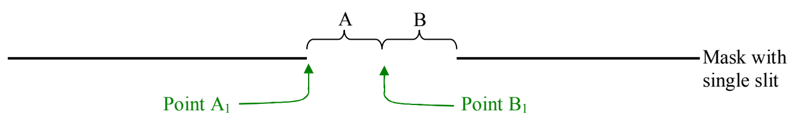

So now the question is, “Under what conditions will there be completely destructive interference along a line such as the one depicted to be at angle  $\theta$  above?” To get at the answer, we first divide the slit in half. I’m going to enlarge the mask so that you can see what I mean.

Now I imagine dividing side A up into an infinite number of pieces and side B up the same way. When the slit is illuminated by the light, each piece becomes a point source. Consider the first point source (counting from the left) on side A and the first point source (again counting from the left) on side B. These two point sources are a distance w/2 apart, where w is the width of the slit. If the light from these two point sources (which are in phase with each other because they are really both part of the same incoming plane wave), interferes completely destructively, at some angle  $\theta$  with respect to the straight-ahead direction, then the light from the second point source on side A and the second point source on side B will also interfere with each other completely destructively because these two point sources are also w/2 apart. The same goes for the third-from-the-left point sources on both sides, the fourth, the fifth, and so on, ad infinitum. So, all we need is to establish the condition that makes the light from the leftmost point source on side A (overall, the leftmost point of the slit) interfere completely destructively with the leftmost point source on side B (overall, essentially the midpoint of the slit). So, consider any point P on a proposed line of minima.
