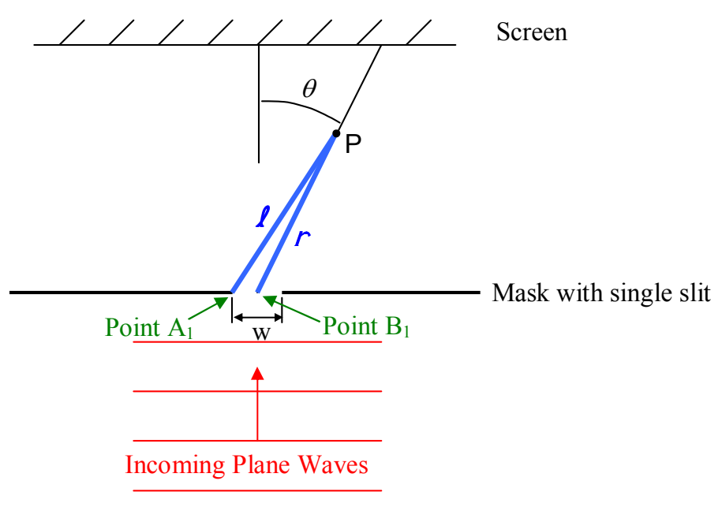

The distance between the two point sources is $w/2$. From the analysis done for the case of two-slit interference, we know that this results in a path difference $\ell - r = \frac{w}{2} \sin \theta$. And, as you know, the condition for completely destructive interference is that the path difference is half a wavelength, or, any integer number of wavelengths plus a half a wavelength. So, we have a minimum along any angle $\theta$ (less than $90^{\circ}$) such that:

$$\left(m + \frac{1}{2}\right) \lambda = \frac{w}{2} \sin \theta \quad (m = 0, 1, 2, \ldots)$$

Now we turn our attention to the question of diffraction maxima. I should warn you that this analysis takes an unexpected turn. We do the exact same thing that we did to locate the minima, except that we set the path difference $\ell - r$ equal to an integer number of wavelengths (instead of a half a wavelength plus an integer number of wavelengths). This means that the path to point $P$ from the leftmost point on side A (position $A_1$) of the slit, differs by an integer number of wavelengths, from the path to point $P$ from the leftmost point on side B (position $B_1$). This will also hold true for the path from $A_2$ vs. the path from $B_2$. It will hold true for the path from $A_3$ vs. the path from $B_3$ as well. Indeed, it will hold true for any pair of corresponding points, one from side A and one point from side B. So, at point $P$, we have maximally constructive interference for every pair of corresponding points along the width of the slit. There is, however, a problem. While, for any pair of points, the oscillations at $P$ will be maximal; that just means that $P$ is at an angle that will make the amplitude of the oscillations of the electric field due to the pair of points maximal. But the electric field due to the pair of points will still be oscillating, e.g. from max up, to 0, to max down, to 0, and back to max up. And, these oscillations will not be in synchronization with the maximal oscillations due to other pairs of points. So, the grand total will not necessarily correspond to an intensity maximum. The big difference between this case and the minima case is that, in contrast to the time varying maximal oscillations just discussed,
