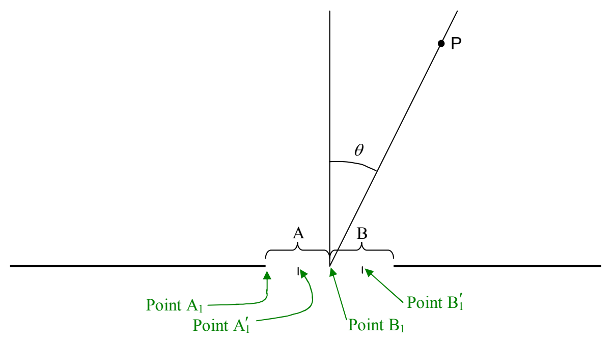

when a pair of contributions results in an electric field amplitude of zero, the electric field due to the pair is always zero. It is constant at zero. And, when every pair in an infinite sum of pairs contributes zero to the sum, at every instant in time, the result is zero. In fact, in our attempt to locate the angles at which maxima will occur, we have actually found some more minima. We can see this if we sum the contributions in a different order.

Consider the following diagram in which each half of the slit has itself been divided up into two parts:

If the path difference between “$A_1$ to $P$” and “$B_1$ to $P$”, is one wavelength, then the path difference between “$A_1$ to $P$” and “$A'_1$ to $P$” must be half a wavelength. This yields completely destructive interference. Likewise for the path difference between “$B_1$ to $P$” and “$B'_1$ to $P$”. So, for each half of the slit (with each half itself being divided in half) we can do the same kind of pair-wise sum that we did for the whole slit before. And, we get the same result—an infinite number of zero contributions to the electric field at $P$. All we have really done is to treat each half of the slit the way we treated the original slit. For the entire slit we found

$$
\left(m + \frac{1}{2}\right)\lambda = \frac{w}{2}\sin\theta \qquad (m = 0, 1, 2, \ldots)
$$

Here we get the same result but with $w$ itself replaced by $w/2$ (since we are dealing with half the slit at a time.) So now we have:

$$
\left(m + \frac{1}{2}\right)\lambda = \frac{w}{4}\sin\theta \qquad (m = 0, 1, 2, \ldots)
$$
