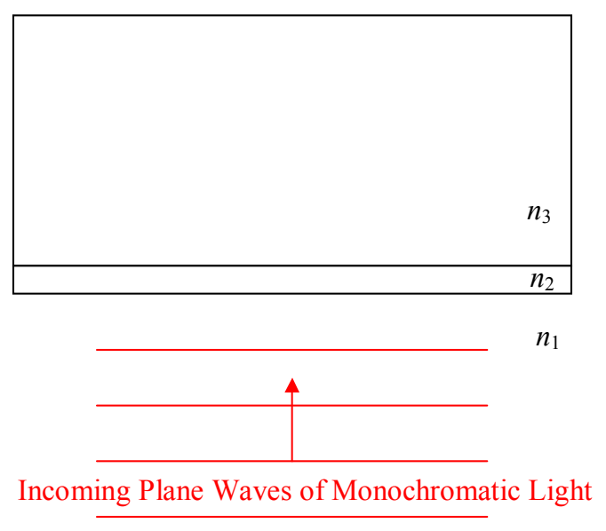

# 24 Thin Film Interference

As the name and context imply, thin-film interference is another interference phenomenon involving light. Here’s the picture, as viewed from above:

Involved are three transparent media: medium 1, medium 2, and medium 3, of index of refraction $n_1$, $n_2$, and $n_3$, respectively. (In general, a medium is a substance, but, in this context, vacuum is also considered a medium. The index of refraction $n$ of a medium is the ratio of the speed of light in vacuum to the speed of light in that medium.) The phenomenon occurs whether or not $n_1 = n_3$, but, $n_2$ must be different from $n_1$ and $n_3$. Medium 2 is the “thin film.” For thin-film interference to occur, the thickness of medium 2 must be on the order of the wavelength of the light. (The actual maximum thickness for which thin-film interference can occur depends on the coherence of the light.)

Here’s the deal: Under most circumstances, when light encounters a smooth interface between two transparent media, some of the light goes through (transmitted light) and some of the light bounces off (reflected light). In the thin-film arrangement of three transparent media depicted above, for certain thicknesses of the thin film (medium 2) all the light can be reflected, and, for certain other thicknesses, all the light can be transmitted. You see this phenomenon when looking at soap bubbles, and sometimes when looking at puddles in the road (when there is a thin layer of oil on top of the water). Humans take advantage of the phenomenon by putting a thin coating of a transparent substance on lenses such as camera lenses and binocular lenses, a layer of just the right thickness for maximum transmission.

Based on the situations in which it occurs, it should be clear that we do not need monochromatic light to make thin-film interference happen. However, I am going to discuss it in terms of monochromatic light to get the idea across. Once you understand it in terms of monochromatic
