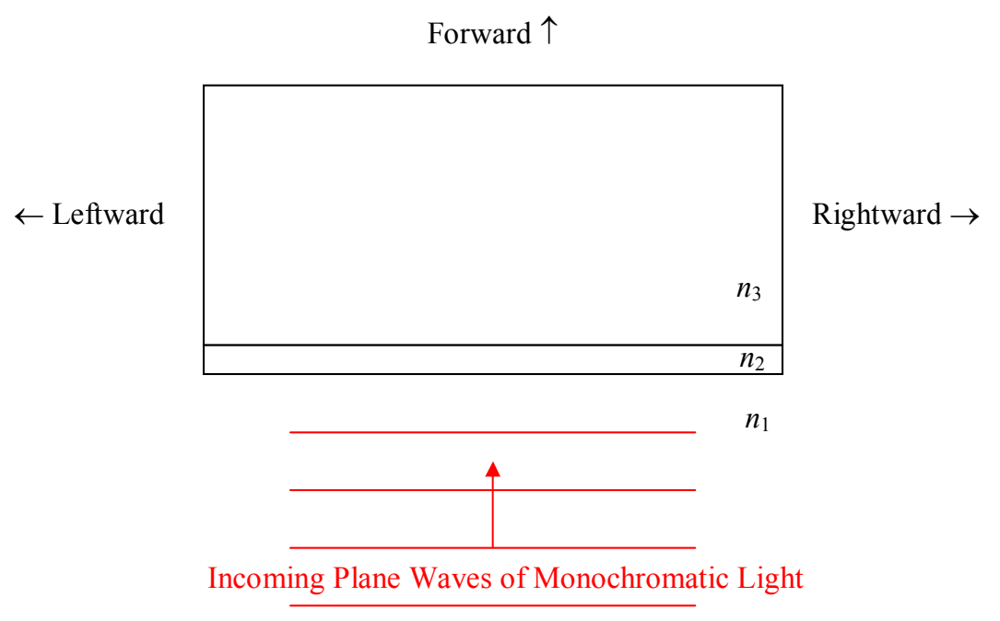

light, you can apply it to white light (a mixture of all the visible frequencies) to answer questions such as, “What wavelength of incoming white light will experience maximum reflection?” The answer helps one understand the rainbow of colors you might see on the surface of a puddle in broad daylight. You put a clear layer of gasoline on top of a clear puddle of water and thin-film interference results in maximal constructive interference of the reflected light, at certain wavelengths.

Based on your experience with soap bubbles and puddle surfaces, you know that the light does not have to be normally incident upon the interface between transparent media in order for thin-film interference to occur. However, the analysis is easier for the case of normal incidence, so, in this chapter, I am going to limit our analysis to the case of normal incidence.

Here's the gross idea: In going through a thin transparent film, light encounters two interfaces, the $n_1$ abutting $n_2$ interface, and, the $n_2$ abutting $n_3$ interface. At each interface, some of the light gets through and some is reflected. We can say all that we need to say about thin-film interference, just by talking about the reflected light. The thing is, light reflected off the second interface interferes with light reflected off the first interface. The reflected light can be thought of as being from two sources at two different locations, one source being the $n_1$ abutting $n_2$ interface, and the other being the $n_2$ abutting $n_3$ interface. But, there is a fixed phase difference between the light from the two sources because the light was originally part of one and the same source of incoming light. The light reflected from the second interface travels farther, to arrive back at the same backward position, than the light reflected from the first interface does. If you figure, that, when that extra distance is one wavelength, the interference of reflected light is constructive, and that, when that extra distance is half a wavelength, the interference of reflected light is destructive, then you've got the right idea, but, there are two “complications” that need to be taken into account.
