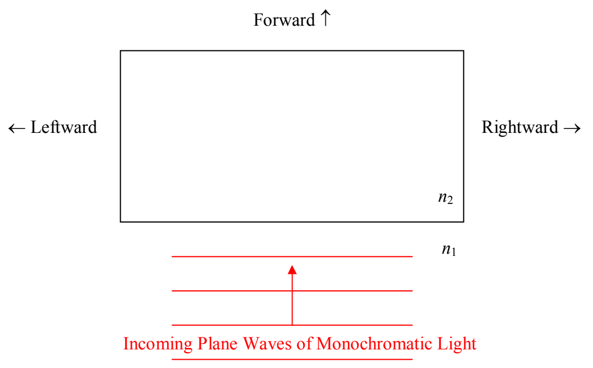

The first complication has to do with phase reversal upon reflection. Consider a single interface (forget about the thin film for a moment) between two transparent medium. Assume light to be incident upon the interface. Call the index of refraction of the medium in which the light is initially traveling,  $n_{1}$ , and call the index of refraction of the medium in which the transmitted light travels,  $n_{2}$ . Experimentally we find that if  $n_{2} > n_{1}$ , then the reflected light is phase reversed, but, that if  $n_{2} < n_{1}$ , the reflected light experiences no phase change at all.

Regarding what we mean by phase reversal: Think of a crest of a wave hitting the interface. More specifically, let the electric field be oscillating along the vertical (into and out of the page in the diagram) so that at the instant under consideration, we have a forward-moving maximum upward-directed electric field vector at the location of the interface. An infinitesimal time dt later, we will find a forward-moving maximum-upward electric field vector at a point  $v_{2}dt$  forward of the interface. If  $n_{2} > n_{1}$  (phase reversal condition met), then, at the same instant in time (dt after the forward-moving maximum upward-directed electric field vector hits the interface) we have a maximum downward-directed electric field vector, traveling backward, at a point  $v_{1}dt$  behind the interface. This is what we mean by phase reversal. An incoming electric field vector pointing in one direction, bounces off the interface as an electric field vector pointing in the opposite direction. If there is no phase reversal, then, at the specified instant in time, we would have a maximum upward-directed electric field vector, traveling backward, at a point  $v_{1}dt$  behind the interface. With no phase reversal, an electric field vector pointing in one direction, bounces off the interface as an electric field vector pointing in the same direction.
