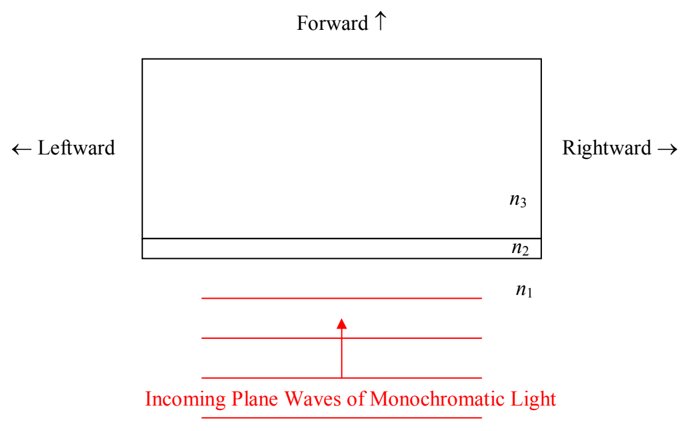

Now back to the thin-film setup:

Recall that to get back to some specified point in space, light reflecting off the second interface (between medium 2 and medium 3) travels farther than the light reflecting off the first interface (between medium 1 and medium 2). Before, we hypothesized that if the path difference was a half a wavelength, the light from the two “sources” would interfere destructively, but, that if it was a full wavelength, the interference would be constructive. Now, if there is no phase reversal from either surface (because  $n_{2} < n_{1}$  and  $n_{3} < n_{2}$ ), or, if there is phase reversal from both surfaces (because  $n_{2} > n_{1}$  and  $n_{3} > n_{2}$ ) then our original hypothesis is still viable. But, if we have phase reversal at one of the interfaces but not the other ( $n_{2} > n_{1}$  but  $n_{3} < n_{2}$ , or,  $n_{3} > n_{2}$  but  $n_{2} < n_{1}$ ), then the situation is reversed. A path difference of one wavelength would result in a crest interfering with a “crest that upon reflection turned into a trough” meaning that a path difference of one wavelength would result in destructive interference. And, a path difference of half a wavelength would result in a crest interfering with a “trough that upon reflection turned into a crest” meaning that a path difference of half a wavelength would result in constructive interference. Okay, we have addressed the phase reversal issue. We have one more complication to deal with. The thing is, the light that bounces off the second interface, not only travels a greater distance, but, it travels at a different speed while it is traveling that extra distance because it is in a different medium. Let’s see how this complication plays out.

The phenomenon holds true for every part of the wave. I focus the attention on crests, just because I find them easier to keep track of. For now, I also want to focus attention on the no-phase-reversal constructive interference case. Consider an instant when a crest of the forward-traveling incoming wave hits the first interface. The crest of the transmitted wave travels through the interface, proceeds through the second medium at speed  $v_{2}=c/n_{2}$ , bounces off the interface with the third medium, and travels back through the second medium, completing its
