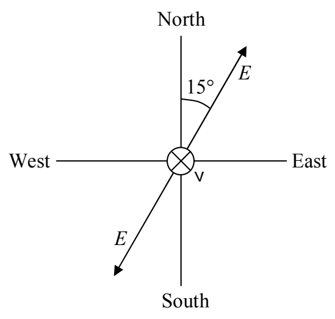
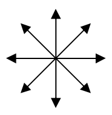

## 25 Polarization

The polarization direction of light refers to the two directions or one of the two directions in which the electric field is oscillating. For the case of completely polarized light there are always two directions that could be called the polarization direction. If a single direction is specified, then that direction, and the exact opposite direction, are both the directions of polarization. Still, specifying one direction completely specifies the direction of polarization. For instance for light that is traveling straight downward near the surface of the earth, if the polarization direction is said to be a compass heading of  $15^{\circ}$ , that unambiguously means that the electric field oscillates so that it is at times pointing in the direction with a compass heading of  $15^{\circ}$ , and at times pointing in the direction with a compass heading of  $195^{\circ}$  ( $15^{\circ}$  west of south).

Randomly polarized light, a.k.a. unpolarized light, has electric field oscillations in each and every direction perpendicular to the direction in which the light is traveling. Such light is often depicted, as viewed from behind, (where forward is the direction in which the light is traveling) as:

Unpolarized Light, a.k.a.
Randomly Polarized Light
