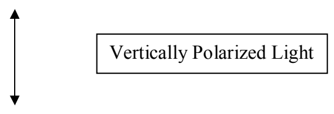
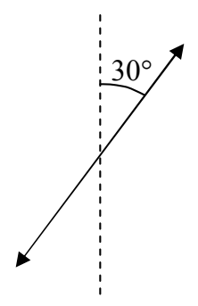
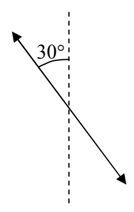

Vertically polarized light traveling horizontally away from you is typically depicted as:

where the direction in which the light is traveling is “into the page” and upward is “toward the top of the page.” At a particular position through which the light is traveling, starting at an instant when the electric field vector at that position is upward and maximum, the electric field will decrease to zero, then be downward and increasing, reach a maximum downward, then be downward and decreasing, become zero, then be upward and increasing, then reach a maximum upward, and repeat, continually. The diagram depicting the polarization indicates the directions that the electric field does point, at some time during its oscillations. It in no way is meant to imply that the electric field is pointing in two directions at the same time.

Light that is traveling horizontally away from you that is polarized at $30^{\circ}$ with respect to the vertical could be either:

or

