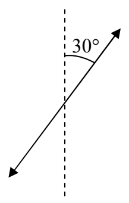
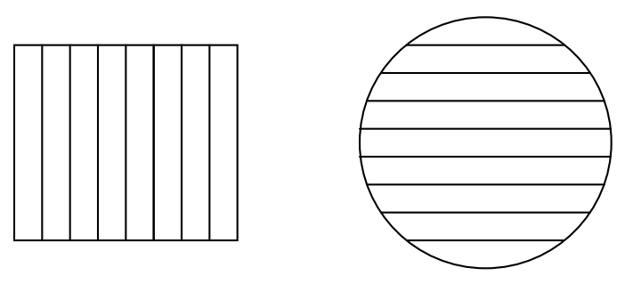

If you encounter such an ambiguous specification of polarization in a problem statement then the answer is the same for either case, so, it doesn’t matter which of the two possible polarization directions you pick. Pick one arbitrarily and work with it.

Light that is traveling horizontally away from you and is polarized, from your point of view, at $30^{\circ}$ clockwise from the vertical is, however, unambiguously:

## Polarizers

A plastic material is manufactured in the form of flat sheets that polarize light that travels through them. A sample of such a flat sheet is called a polarizer. In use, one typically causes light to travel toward a polarizer along a direction that is perpendicular to the polarizer. In other words, one causes the light to be normally incident upon the polarizer.

Schematically, one typically depicts a polarizer by means of a rectangle or a circle filled with parallel line segments.

The orientation of the lines is referred to as the polarization direction of the polarizer. The effect of a polarizer is to transmit light that is polarized in the same direction as that of the polarizer, and to block (absorb or reflect) light that is polarized at right angles to the direction of the polarizer.

The polarization direction of the rectangular polarizer depicted above is vertical. So, it lets vertically-polarized light through and blocks horizontally-polarized light.

The polarization direction of the circle-shaped sample of polarizing material depicted above is horizontal. So, it lets horizontally-polarized light through and blocks vertically-polarized light.
