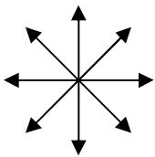
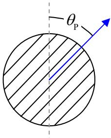
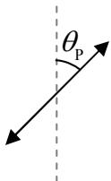

When unpolarized light (a.k.a. randomly-polarized light) is normally incident on any polarizer, half the light gets through. So, if the intensity of the incoming light is  $I_{0}$ , then the intensity of the light that gets through, call it  $I_{1}$ , is given by:

$$I _ {1} = \frac {1}{2} I _ {0} \tag {25-1}$$

In completely unpolarized light, the electric field vectors are oscillating in every direction that is perpendicular to the direction in which the light is traveling. But all the electric field vectors are, as the name implies, vectors. As such, we can break every single one of them up into a component along the direction of polarization of the polarizer and a component that is perpendicular to the polarization direction of the polarizer. A polarizer will let every component that is along the direction of polarization of the polarizer through, and block every component that is perpendicular to the polarization direction. In completely unpolarized light, no matter what the direction of polarization of the polarizer is, if you break up all the electric field vectors into components parallel to and perpendicular to the polarizer's polarization direction, and add all the parallel components together, and then separately add all the perpendicular components together, the two results will have the same magnitude. This means that we can view completely unpolarized light as being made up of two halves: half polarized parallel to the polarizer's polarization direction, and half polarized perpendicular to the polarizer's polarization direction. The half that is polarized parallel to the polarizer's polarization direction gets through the polarizer, and the other half doesn't.

## Unpolarized Light Traveling Directly Away From You

<table><tr><td>When completely unpolarized light of intensity $I_0$ ...</td><td>... is normally incident on a polarizer whose polarization direction makes an angle $\theta_p$ with the vertical...</td><td>... the light that gets through is polarized in the polarizer&#x27;s direction of polarization, and, has an intensity $I_1 = \frac{1}{2} I_0$.</td></tr></table>

Note how the effect of a polarizer on the intensity of normally-incident unpolarized light does not depend on the orientation of the polarizer. You get the same intensity  $I_{1} = \frac{1}{2} I_{0}$  of light getting through the polarizer, no matter what the direction of polarization of the polarizer is.
