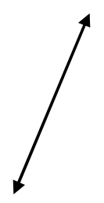
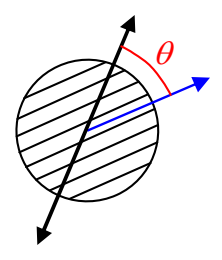
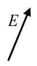
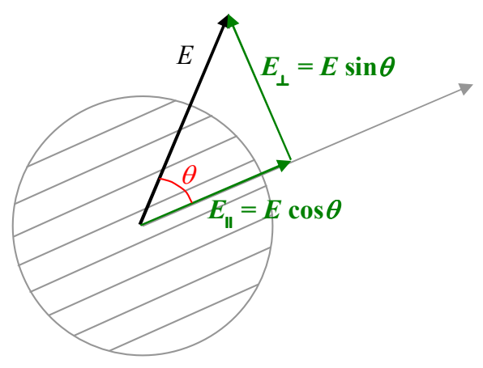

Now suppose that we have some light that, for whatever reason, is already polarized. When polarized light is normally incident on a polarizer, the intensity of the light that gets through does depend on the direction of polarization of the polarizer (relative to that of the incoming light). Suppose for instance, that the incoming light,

is polarized at an angle  $\theta$  with respect to the polarization direction of a polarizer upon which the light is normally incident:

Before it hits the polarizer, the light's electric-field-oscillations-amplitude vector,

can be broken up into a component parallel to the polarizer's polarization direction and a component perpendicular to the polarizer's polarization direction.

