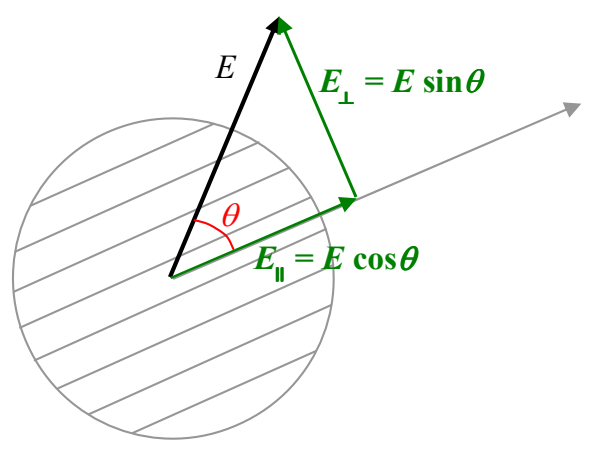
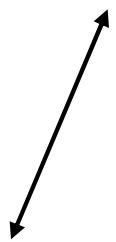
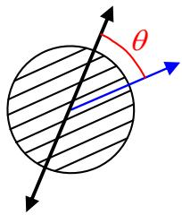
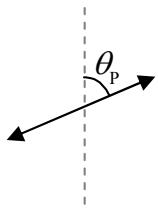

The parallel component  $E_{\parallel} = E \cos \theta$  gets through the polarizer, the perpendicular component does not.

Now the intensity of polarized light is proportional to the square of the amplitude of the oscillations of the electric field. So, we can express the intensity of the incoming light as

$$I _ {0} = (\text { constant })   E ^ {2}$$

and the intensity of the light that gets through as:

$$I _ {1} = (\text {constant}) E _ {\parallel} ^ {2}$$

$$I _ {1} = (\text {constant}) (E \cos \theta) ^ {2}$$

$$I _ {1} = (\text {constant}) E ^ {2} (\cos \theta) ^ {2}$$

$$I _ {1} = I _ {0} (\cos \theta) ^ {2} \tag {25-2}$$

Summarizing:

## Polarized Light Traveling Directly Away From You

<table><tr><td>When polarized light of intensity $I_0$ ...</td><td> ... is normally incident on a polarizer whose polarization direction makes an angle $\theta$ with the polarization direction of the light...</td><td> ... the light that gets through is polarized in the polarizer&#x27;s direction of polarization, and, has an intensity $I_1 = I_0 (\cos \theta)^2$.</td></tr></table>
