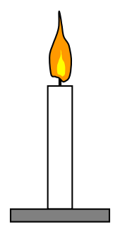
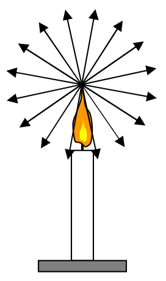

## 26 Geometric Optics, Reflection

We now turn to a branch of optics referred to as geometric optics and also referred to as ray optics. It applies in cases where the dimensions of the objects (and apertures) with which the light interacts are so large as to render diffraction effects negligible. In geometric optics we treat light as being made up of an infinite set of narrow beams of light, called light rays, or simply rays, traveling through vacuum or transparent media along straight line paths. Where a ray of light encounters the surface of a mirror, or the interface between the transparent medium in which it (the light) is traveling and another transparent medium, the ray makes an abrupt change in direction, after which, it travels along a new straight line path.

In the geometric optics model of light, we see light emitted by sources of light because the light enters our eyes. Consider for instance, a candle.

Every point of the flame of the candle emits rays of light in every direction.

While the preceding diagram conveys the idea in the statement preceding the diagram, the diagram is not the complete picture. To get a more complete picture of what's going on, what I want you to do is to look at the diagram provided, form a picture of it in your mind, and, to the picture in your mind, add the following embellishments:
