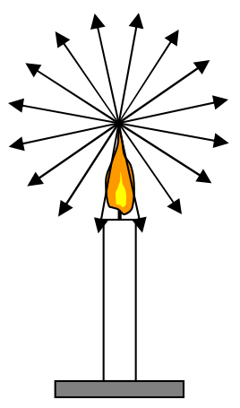

1. First off, I need you to imagine it to be a real candle extending in three dimensions. Our set of rays depicted as arrows whose tips are all on a circle becomes a set of rays depicted as arrows whose tips all end on a sphere. Thus, in addition to rays going (at various angles) upward, downward and to the sides, you've got rays proceeding (at various angles) away from you and toward you.

2. Now I need you to add more rays to the picture in your mind. I included 16 rays in the diagram. In three dimensions, you should have about 120 rays in the picture in your mind. I need you to bump that up to infinity.

3. In the original diagram, I showed rays coming only from the tip of the flame. At this point, we have an infinite number of rays coming from the tip of the flame. I need you to picture that to be the case for each point of the flame, not just the tip of the flame. In the interest of simplicity, in the picture in your mind, let the flame of the candle be an opaque solid rather than gaseous, so that we can treat all our rays as coming from points on the surface of the flame. Neglect any rays that are in any way directed into the flame itself (don't include them in the picture in your mind). Upon completion of this step, you should have, in the picture in your mind, an infinite number of rays coming from each of the infinite number of points making up the surface of the flame.

4. For this next part, we need to establish the setting. I'm concerned that you might be reading this in a room in which lit candles are forbidden. If so, please relocate the candle in the picture in your mind to the dining room table in your home, or, replace the candle with a fake electric-powered candle such as you might see in a home around Christmastime. Now I need you to extend each of the rays in the picture in your mind all the way out to the point where they bump into something. Please end each ray at the point where it bumps into something. (A ray that bumps into a non-shiny surface, bounces off in all directions [diffuse reflection]. Thus, each ray that bumps into a non-shiny surface creates an infinite set of rays coming from the point of impact. A ray bumping into perfectly shiny surfaces continues as a single ray in one particular, new, direction [specular reflection]. To avoid clutter, let's omit all the reflected rays from the picture in your mind.)

If you have carried out steps 1-4 above, then you have the picture, in your mind, of the geometric optics model of the light given off by a light-emitting object. When you are in a room with a candle such as the one we have been discussing, you can tell where it is (in what direction and how far away—you might not be able to give very accurate values, but you can tell where it is) by looking at it. When you look at it, an infinite number of rays, from each part of the surface of
