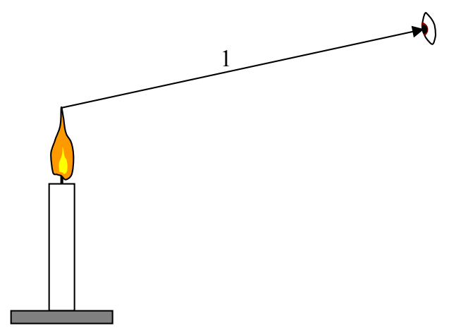
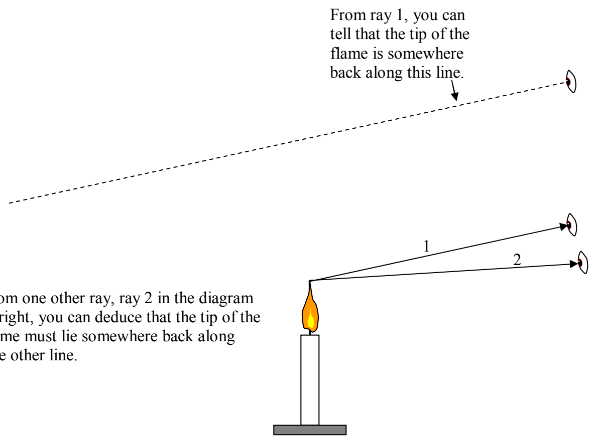

the flame, are entering your eyes. What is amazing is how few rays you need to determine where, for instance, the tip of the flame is. Of the infinite number of rays available to you, you only need two! Consider what you can find out from a single ray entering your eye:

From just one of the infinite number of rays, you can deduce the direction that the tip of the flame is in, relative to you. In other words, you can say that the tip of the flame lies somewhere on the line segment that both contains the ray that enters your eye, and, that ends at the location of your eye.

From one other ray, ray 2 in the diagram at right, you can deduce that the tip of the flame must lie somewhere back along one other line.
